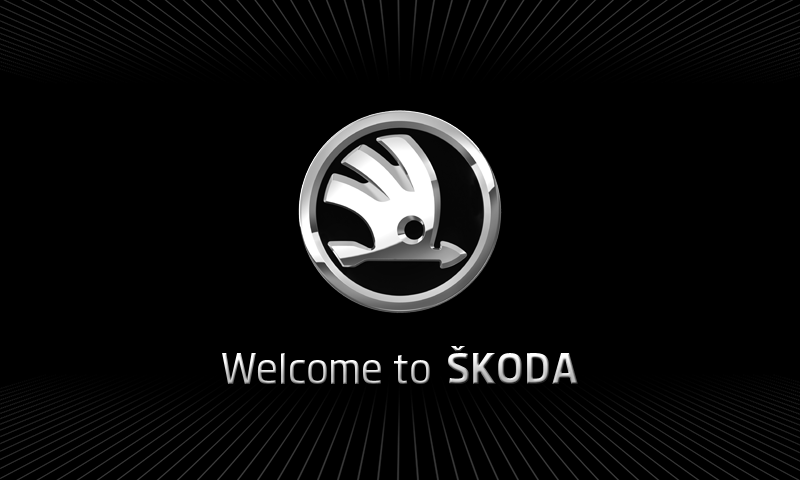

# NoName "Skoda theme" — what it actually is, and the Desay equivalent

Analysis of `E:\…\NoName\Skoda\5606 BT\std_plus_pss-6.5inch_166108-7.1.1.2_SKODA_PQ.tar`
(byte-identical to the library copy `V5606_Skoda\CN+EN\…`, AP_VER **7.1.1.2**, BT C210, MQB V7071)
compared against a VW pack (`V5624`, AP_VER 8.8.9.1) and against the Desay rootfs.

## 1. What the Skoda pack changes

| Item | Skoda pack (7.1.1.2) | VW pack (8.8.9.1) |
|---|---|---|
| `opt/gresfiles/Startscreen*.png` | **24 files, all byte-identical** (md5 `adeb9b3318…`, 125,939 B, 800×480) | 50 files, distinct per variant (ASIA / EU / NAR sets + root) |
| `opt/hmi` | 10,282,460 B, md5 `b1a2eb4f…` | 9,832,364 B, md5 `85eebc48…` (different build — not directly comparable) |
| Branding visible to the user | **"Welcome to ŠKODA"** 800×480 start screen on every slot | "WELCOME TO VOLKSWAGEN" per-variant screens |

So the NoName "Skoda theme" is elegantly simple: **the same 800×480 "Welcome to …" artwork with
the brand changed, written into every start-screen slot** so whichever index is configured shows
it. (`logo_skoda.tar` in `30-Mods-Patches` carries the same artwork again as a raw
`/dev/mtdblock5` splash for the pre-UI boot stage.)



## 2. The Desay equivalent already exists — same artwork, same geometry

The Desay rootfs has `/usr/share/rvc/logo/`:

| file | size | layout |
|---|---|---|
| `Startscreen_Alltrack/Normal/GTI/GTD/R/R_Line/GTE/E_Golf/Twin_Drive/Beats_Audio/Blue_Motion/Dynaudio/Family.ppm` | **1,536,015 B each** | `P6\n800 480\n255\n` (15 B) + **1,152,000 B RGB (800×480)** + **384,000 B zero padding** |
| `Mazda.ppm` | 1,152,015 B | same but unpadded |
| `opening_ttl.avi` | 154,510 B | start animation |

Decoded, the Desay `Startscreen_Normal.ppm` is **the same "WELCOME TO VOLKSWAGEN" design** as the
NoName VW screens:


**Verified facts:**
- all **13/13** Desay startscreens share the identical `P6 / 800×480 / 1,536,015 B` layout;
- pixel data is plain RGB (no channel swap needed);
- the selection is a **logo index in NOR** (`logo_os`: `get logo path index from nor`,
  `Logo_Name_Array`, `load/save_exlap_logo_index`, default fallback).

## 3. Consequence: the Desay Skoda mod is now fully specified

Because every startscreen is exactly the same size, we can replace **all 13** with the Skoda
artwork — the unit shows Skoda whichever index is configured, with **no need to touch the NOR
index**.

```
Skoda artwork 800x480 (from the 5606 Skoda pack, or the logo_skoda splash)
   -> Desay payload: "P6\n800 480\n255\n" + 1,152,000 B RGB + 384,000 B padding = 1,536,015 B
   -> patch targetfs.img in place (13 files, same length -> no filesystem rebuild)
   -> gzip -> targetfs.bin -> rebuild os.bin's 14-entry table
   -> rebuild the outer 5-record container -> md5sum -> update .md5 (keep VERSION/ROLL_BACK_NO)
   -> verify by re-extracting and diffing every member
   -> flash (only after backup + recovery path)
```

Generator: `tools/desay/make_startscreen_ppm.py` (produces the padded PPM, verifies the
round-trip, and can emit the 13-slot set). A generated `SKODA_Startscreen_Normal.ppm`
(1,536,015 B, md5 `079a5ec0a7d8af3493a5a969defe8aaf`) round-trips byte-identically.

## 4. What this does and does not buy

| Achieved by this mod | Not achieved |
|---|---|
| Skoda **start screen** (the visible "Welcome to ŠKODA" splash) | Skoda **UI theme** — in-unit menus, colours and icons still come from `VW_MP2017*.kzb` Kanzi bundles |
| option: Skoda **CarPlay OEM icon** (`share/CarPlay/*.png` in `svp.bin`) | Android Auto (no stack, no HU certificate) |
| option: replace the start animation (`opening_ttl.avi`) | MCU/radio behaviour |

That is exactly the same scope the NoName community delivers with its "Skoda theme" packs — the
splash and the brand icon — with one difference: on the clone it is a 20-second unsigned tar,
while here it requires a rebuilt, md5-valid image and a recovery plan.

## 5. Method notes (for reproducibility)

- Skoda pack: `tools/desay/` comparison scripts; startscreens are uniform, `opt/hmi` differs by
  build so HMI differences cannot be attributed to branding alone.
- Desay PPM format determined empirically: header `P6\n800 480\n255\n`, 1,152,000 B RGB,
  384,000 B padding; verified by decoding a stock file and by round-tripping the generated one.
- `Mazda.ppm` (1,152,015 B) is the unpadded variant — evidence that the 384,000 B tail is
  alignment padding, not pixel data.
